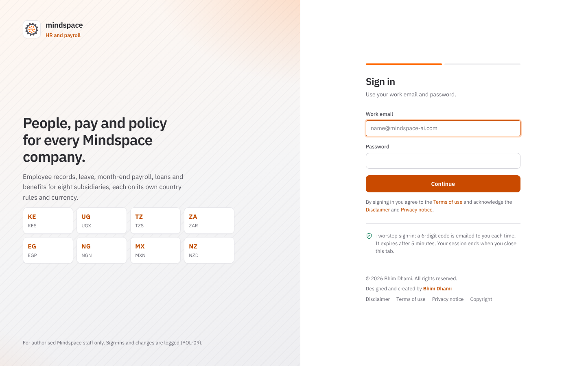
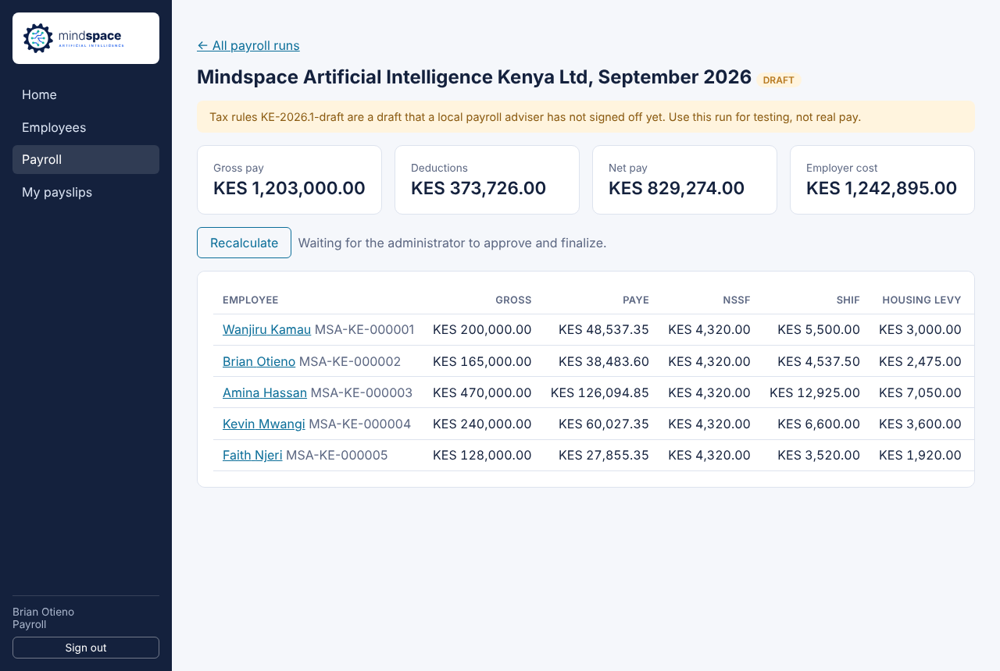
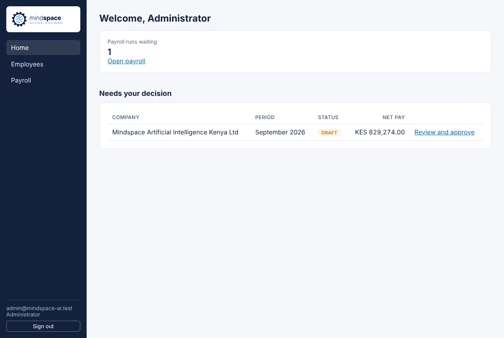
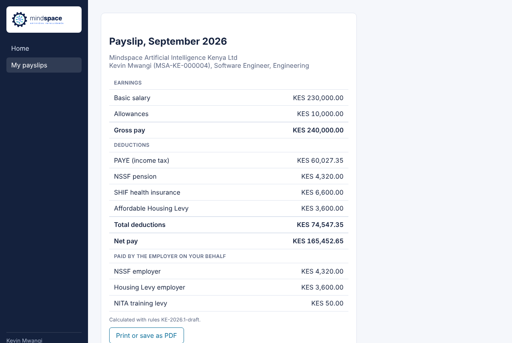
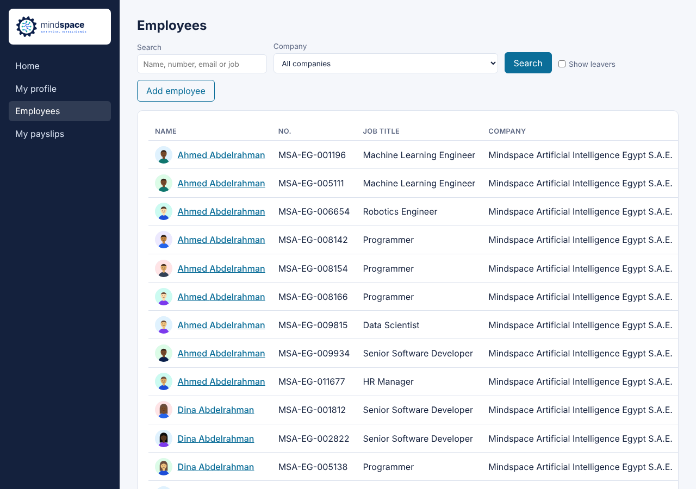
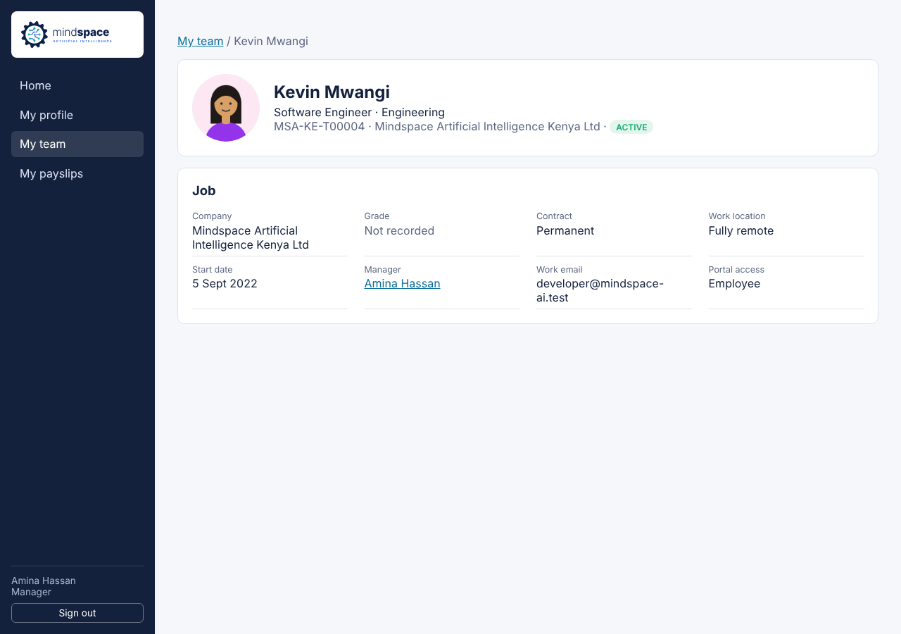
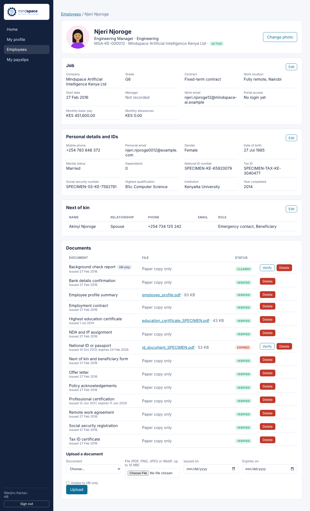

# Mindspace HR Portal

HR and payroll portal for **Mindspace Artificial Intelligence Inc.** and its subsidiaries in Kenya, Uganda, Tanzania, South Africa, Egypt, Nigeria, Mexico and New Zealand.

Done so far:

- **Milestone 1:** secure sign-in, employee records, and the month-end payroll run with payslips. Kenya is the first country with payroll rules; the other countries come next.
- **Milestone 2:** staff profiles with photos, contact details, IDs, education, next of kin and HR documents, plus an import of 12,408 sample staff.

| Part | Stack |
|---|---|
| `apps/api` | NestJS 11, Prisma 6, PostgreSQL 16 |
| `apps/web` | Next.js 15, React 19 |
| Email in development | Mailpit (catches every email locally) |
| CAPTCHA | Cloudflare Turnstile (free) |

## Quick start

You need Node 22 and Docker.

```bash
docker compose up -d                 # Postgres on 5432, Mailpit on 8025/1025
cp .env.example apps/api/.env
cp apps/web/.env.example apps/web/.env.local
npm install
npm run db:migrate
npm run db:seed                      # companies and the six test accounts
npm run db:import-sample             # optional: 12,408 sample staff with documents and photos
npm run dev:api                      # http://localhost:4000/api
npm run dev:web                      # http://localhost:3000
```

Open **http://localhost:3000** for the portal and **http://localhost:8025** for the test inboxes. In GitHub Codespaces, run `dev:api` and `dev:web` in two terminals, then open ports 3000 and 8025 from the **Ports** tab.

Open the test inbox to see the emails. Every email the portal sends (sign-in codes, welcome emails, payslip notices) lands there, so the test accounts need no real mailbox.

## Test accounts

All emails use the reserved `.test` domain, so nothing can ever reach a real person.

| Email | Password | Role | What they can do |
|---|---|---|---|
| admin@mindspace-ai.test | `Admin#Mindspace2026` | Administrator | Everything: add and delete employees, give any role, approve and finalize payroll |
| hr@mindspace-ai.test | `Test#Mindspace2026` | HR | Add and edit employees (employee or manager role only) |
| payroll@mindspace-ai.test | `Test#Mindspace2026` | Payroll | Create and recalculate payroll drafts |
| manager@mindspace-ai.test | `Test#Mindspace2026` | Manager | See their own team (no pay figures) |
| developer@mindspace-ai.test | `Test#Mindspace2026` | Employee | Own profile and payslips (fully remote) |
| tester@mindspace-ai.test | `Test#Mindspace2026` | Employee | Own profile and payslips |

Change the passwords with `SEED_ADMIN_PASSWORD` and `SEED_USER_PASSWORD` before seeding anything other than a laptop. The seed refuses to run with `NODE_ENV=production` unless both are set.

## Staff profiles

Every employee has a profile page (**My profile** in the menu for your own). It holds job details, contact details, IDs, education, up to five next of kin, a profile photo and HR documents.

| Who | Sees | Can change |
|---|---|---|
| HR and admin | Everything, including HR-only documents | Everything; their uploads are verified straight away; verify, reject or delete documents |
| Payroll | Everything, including pay and IDs | Nothing |
| The employee | Their own profile and documents, except HR-only ones | Phone, personal email, marital status, dependants, next of kin and photo; uploads wait for HR to verify |
| Their manager | Job details and photo of their direct reports | Nothing (no pay, IDs, next of kin or documents) |

Uploads must be PDF, PNG, JPEG or WebP (checked from the file contents, not the name), up to 10 MB; photos up to 5 MB. Files are stored on disk under `apps/api/storage/` (set `STORAGE_DIR` to move it). That folder is not in git.

### Sample staff

`npm run db:import-sample` loads the 12,408 sample employees in `sample-data/` across the eight countries, with one next of kin each, 156,381 document register entries and an avatar for everyone. Eight people have scanned specimen files (ID, education certificate, profile summary). It takes under a minute, skips anyone already imported, and does not create logins, so the sample staff cannot sign in. Run `npm run db:seed` first.

All sample data is fictional, and IDs start with `SPECIMEN`.

## How sign-in works

1. Email, password and a Turnstile CAPTCHA.
2. A 6-digit code is emailed. It expires in 5 minutes and allows 5 tries; at most 5 codes per 15 minutes.
3. The browser keeps the session token for the tab only (8 hours).

The CAPTCHA keys in `.env.example` are Cloudflare's published test keys, which always pass. Put real keys in production.

## Month-end payroll

1. **Draft.** Payroll staff create a run for a company and month, or it is created automatically on the 20th (`PAYROLL_AUTODRAFT=true`), and the admin gets an email.
2. **Approve.** The admin checks totals and approves.
3. **Finalize.** The admin finalizes. Payslips are published and every employee gets an email.

Deleting an employee is a soft delete: their login stops at once, and their record and payslips are kept for the legal retention period.

### Kenya rules (`KE-2026.1-draft`)

PAYE bands with KES 2,400 personal relief; NSSF 6% up to KES 72,000 pensionable pay (employer matches); SHIF 2.75% (minimum KES 300); Affordable Housing Levy 1.5% each side; NITA KES 50 employer levy. NSSF, SHIF and the housing levy are deducted before PAYE.

**These rules are marked unverified.** A Kenyan payroll adviser must sign them off before real pay. Until then the portal shows a warning on every run.

## Tests

```bash
npm run db:test:setup   # migrates the hrportal_test database (created by docker compose)
npm test                # Kenya rule unit tests + full API flow
```

The API test signs in through the email code, checks every role boundary, adds and deletes an employee, runs payroll from draft to finalized, and checks profile access, uploads and the sample import. It wipes its database, so it only runs against a database whose name ends in `_test`.

## Screenshots

| | |
|---|---|
|  |  |
|  |  |
|  |  |


