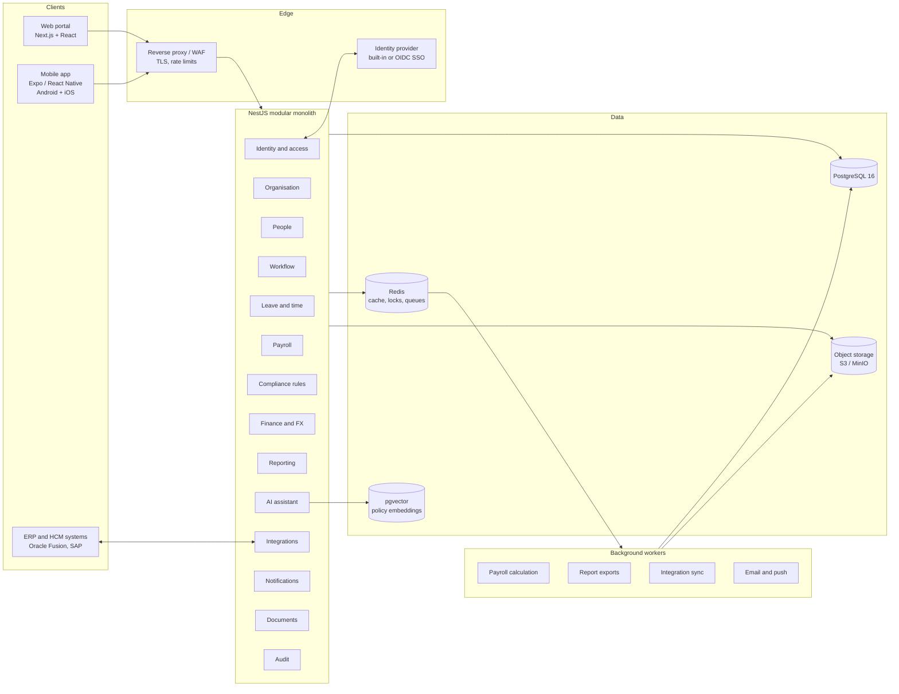

# Solution architecture

## 1. Shape of the system

A **modular monolith** in TypeScript: one NestJS API made of modules with hard boundaries, one Next.js web portal, one Expo mobile app, and shared packages for contracts and the payroll engine. High-volume parts (payroll calculation, reporting, integrations, the assistant) talk to the rest through queues and events, so each can later move into its own service without changing its callers.



## 2. Repository layout

```
apps/
  api/            NestJS 11 API (modular monolith) and background workers
  web/            Next.js 15 web portal (employee, manager, HR, payroll, finance, admin)
  mobile/         Expo app for Android and iOS (phase 7)
packages/
  shared/         Contracts shared by every app: countries, currencies, languages,
                  roles and permissions, brand and theme tokens
  payroll-engine/ Pure, decimal-safe payroll calculation and versioned rule packs (phase 4)
docs/             Requirements, architecture, data model, plans, manuals
infra/            Docker images, deployment templates (Terraform in phase 10)
```

## 3. Module boundaries

Each API module owns its tables and exposes a service interface. Other modules call that interface, never its tables. Cross-module side effects go through domain events (`employee.hired`, `payroll.run.finalised`, ...) written to an outbox table in the same transaction and delivered by a worker, so nothing is lost if a process dies.

| Module | Owns | Phase |
|---|---|---|
| Identity and access | users, sessions, MFA, role assignments, permission resolution | 2 |
| Organisation | group, countries, currencies, legal entities, business units, branches, departments, cost centres, feature flags | 2 |
| People | persons, employments, assignments, effective-dated job and pay history, documents | 2-3 |
| Workflow | workflow definitions, instances, tasks, delegations | 3 |
| Leave and time | leave types, balances, requests, holidays, shifts, attendance, timesheets | 3 |
| Payroll | pay groups, calendars, periods, runs, results, payslips, payment files | 4 |
| Compliance rules | versioned country rule sets with source, verification and approval | 4-5 |
| Finance and FX | exchange rates, journals, GL mappings, intercompany recharges | 4 |
| Reporting | dashboards, report definitions, exports, subscriptions | 6 |
| AI assistant | knowledge collections, retrieval, tool calls, conversation audit | 6 |
| Integrations | connectors, mappings, sync jobs, dead letters | 8 |
| Notifications | templates per language, email, push, in-app | 3 |
| Documents | object storage, malware scanning, retention | 3 |
| Audit | append-only audit log of reads, changes, approvals and exports | 2 |

## 4. Multi-company isolation

- Every business row carries `groupId` and, where it belongs to a company, `legalEntityId`.
- A user's access is a set of **role assignments**, each scoped to the whole group, one country, or one legal entity. The API resolves the scope once per request into the list of legal entities the user may touch for each permission.
- Services filter every query by that list. A request for a record outside it answers *404 Not found*, not *403*, so the existence of other companies' records is not revealed.
- Phase 9 adds PostgreSQL row-level security as a second line of defence, keyed on the same scope.
- Field-level protection: bank details, tax identifiers, medical attachments and employee-relations cases need their own permissions on top of record access.

## 5. Payroll design principles (phase 4)

- The engine is a pure function: `(employee inputs, period, rule set version) → result lines`. It reads nothing from the database itself, which makes runs repeatable and testable.
- Money uses `decimal.js` with rounding set per currency and per rule. Floats never touch money.
- Every result line records the rule set version that produced it.
- A run moves through the lifecycle in the requirements. Each transition is an audited command with an idempotency key. A Redis lock per (legal entity, pay group, period) stops two runs being calculated at once.
- Finalised runs are immutable. Corrections create reversal and adjustment runs linked to the original.
- Simulation runs use the same engine but are stored separately and can never be finalised or paid.

## 6. Compliance rule sets

Rules are data, not code: a rule set per country with effective dates, a version, the source document and URL, the jurisdiction, the verification date, who verified it, and a status of `DRAFT`, `UNVERIFIED`, `VERIFIED` or `RETIRED`. Payslips and reports produced from anything other than `VERIFIED` rules are watermarked as not certified. Only the formula *shapes* (progressive bands, capped percentages, fixed amounts) live in code.

## 7. Authentication

- Phase 2: built-in sign-in with password plus a one-time code by email (TOTP authenticator apps follow), short-lived access tokens (15 minutes) and rotating refresh tokens with reuse detection. The web portal keeps the refresh token in an http-only cookie; the mobile app keeps it in the device's secure keystore.
- The same token issuer is replaced by, or federated with, an external OIDC provider (Microsoft Entra ID, Okta, Keycloak) for SSO in phase 9, without changing the API's permission model.

## 8. Technology choices

| Concern | Choice | Why |
|---|---|---|
| API | NestJS 11, TypeScript | Module system fits the bounded contexts; one language across web, mobile and API |
| ORM and migrations | Prisma 6 | Typed queries, reviewed SQL migrations |
| Database | PostgreSQL 16 | Transactions, JSONB for rule sets, row-level security, pgvector |
| Cache, locks, queues | Redis 7 with BullMQ | Payroll locks, background jobs, rate limits |
| Object storage | S3-compatible (MinIO locally) | Payslips, contracts, attachments |
| Web | Next.js 15, React 19 | Server rendering, routing, i18n |
| Mobile | Expo, React Native | One codebase for Android and iOS |
| API docs | OpenAPI generated by `@nestjs/swagger` at `/api/docs` | Always matches the code |
| Money | decimal.js | Exact decimal arithmetic |
| Validation | class-validator on the API, zod in shared contracts | Reject bad input at the edge |
| Mail in development | Mailpit | Catches every email locally |

## 9. Environments

| Environment | Purpose | Data |
|---|---|---|
| Local | Docker Compose: Postgres, Redis, MinIO, Mailpit | Seeded demo data |
| Test (CI) | Every push: typecheck, unit, API integration tests on a real Postgres | Deterministic seed |
| Staging | Release candidates, load and security tests | Full 45,000-person synthetic set |
| Production | Live | Real data, never copied down |

Deployment templates and monitoring (OpenTelemetry traces, structured logs, metrics, error reporting) arrive in phase 10; the API already writes structured JSON logs and exposes `/api/health`.
