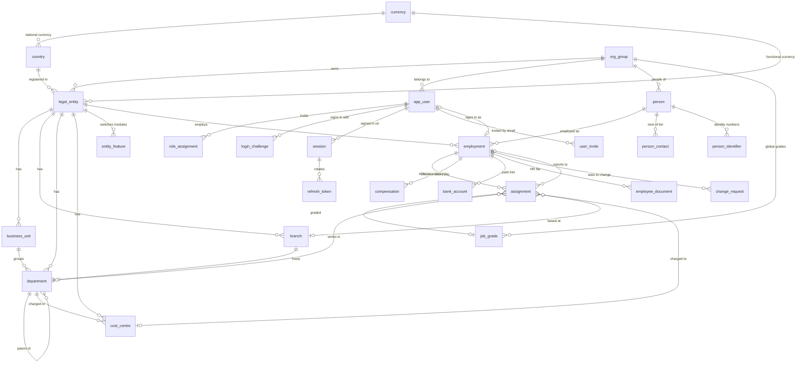
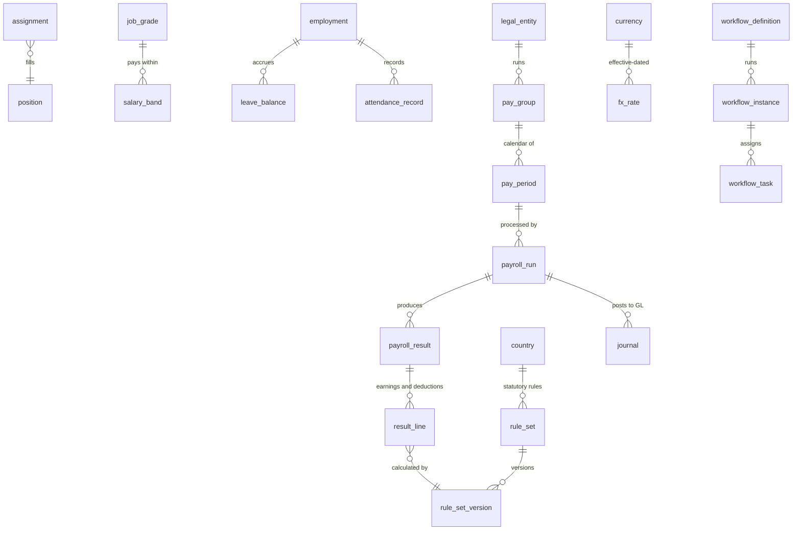

# Data model

PostgreSQL 16. Tables use snake_case names; every business table carries the company (`legal_entity_id`) it belongs to, so access scoping is one indexed filter. The schema lives in `apps/api/prisma/schema.prisma` and changes only through reviewed migrations in `apps/api/prisma/migrations/`.

## 1. Built in phase 2

### Data dictionary

| Table | Purpose | Key columns and rules |
|---|---|---|
| `currency` | ISO 4217 currencies, admin-extendable | `code` (PK, 3 letters), `decimals` (minor units: 0 for UGX, JPY, KRW), `symbol` |
| `language` | Language catalogue | `code` (BCP 47, e.g. `zh-Hans`), `dir` (`ltr`/`rtl`), `status` (`interface` = portal translated) |
| `country` | Operating countries, admin-extendable | `code` (PK, ISO 3166), `currency_code`, `languages[]`, `time_zone` (IANA, validated), `weekend_days[]` (0 = Sunday) |
| `org_group` | The multinational group | `code` unique, `reporting_currency` |
| `legal_entity` | Legal employer; runs its own payroll | unique (`group_id`, `code`); `country_code`; `functional_currency`; `time_zone`, `weekend_days`, `default_language` default from the country; `fiscal_year_start_month`; `is_shared_service_centre`; `status`. Country and currency cannot be changed after creation. |
| `business_unit` | Line of business inside a company | unique (`legal_entity_id`, `code`) |
| `branch` | Office or site | unique (`legal_entity_id`, `code`); `city`; optional own `time_zone` |
| `department` | Department, optionally nested | unique (`legal_entity_id`, `code`); `business_unit_id`, `branch_id`, `parent_id` must be in the same company (checked by the API) |
| `cost_centre` | Where payroll cost is charged | unique (`legal_entity_id`, `code`); `department_id`; `gl_code` for journals |
| `entity_feature` | Module switched on or off per company | PK (`legal_entity_id`, `module`) |
| `app_user` | Sign-in account | `email` unique, stored lower-case; `password_hash` (bcrypt, cost 12) null until the invitation is accepted; `failed_login_count`, `locked_until` |
| `role_assignment` | One role over a scope | `role`; `scope_type` GROUP / COUNTRY / LEGAL_ENTITY with a CHECK constraint that exactly the matching column is set; unique per user, role and scope |
| `login_challenge` | Emailed one-time code | `code_hash` (HMAC-SHA-256 with the server secret), 5-minute expiry, 5 attempts, single use |
| `session` | A signed-in device | `client` web/mobile; absolute `expires_at` (12 hours web, 30 days mobile); `revoked_at` ends it at once |
| `refresh_token` | Rotating refresh token | only the SHA-256 `token_hash` is stored; `used_at` set on rotation; reuse revokes the session |
| `user_invite` | Password-setting link | hashed token, 72-hour expiry, single use |
| `job_grade` | Global grade (G1 Associate to G7 Executive) | unique (`group_id`, `code`); `level`. Job titles stay local on the assignment. |
| `person` | A human being, once per group | `person_number` unique; names, `local_name` in local script, `preferred_name`, gender, birth date, `nationality`, contact details, education, `photo_key` |
| `person_contact` | Next of kin, emergency contacts, beneficiaries | flags `is_emergency_contact`, `is_beneficiary` |
| `person_identifier` | National ID, passport, tax, social security, work permit | `value_encrypted` (AES-256-GCM), `value_last4` for display; unique per person, kind and country |
| `employment` | One period of work for one company | `employee_number` unique (`MSA-<country>-<6 digits>`); `user_id` links the portal account; type, work location, hire, probation and end dates, `status` |
| `assignment` | Effective-dated job | `effective_from` / `effective_to`; reason (HIRE, PROMOTION, TRANSFER, CHANGE, CORRECTION); title, grade, business unit, department, branch, cost centre, `manager_id` (an employment), FTE. Database rules: one open row per employment, one row per start date, end after start. |
| `compensation` | Effective-dated pay | `currency`, `pay_frequency`, `base_amount` and `allowances` as `NUMERIC(18,4)`; same database rules as `assignment`, plus no negative amounts |
| `bank_account` | Where pay goes | `account_number_encrypted`, `account_number_last4`; replaced accounts keep an `effective_to` |
| `employee_document` | HR document register | type, file name, `storage_key` (null when only paper is held), dates, `status`, `hr_only`, who verified it and when |
| `change_request` | Self-service change waiting for HR | `kind` (BANK_ACCOUNT), `payload_encrypted`, `summary`, status, requester and decider |
| `audit_log` | Append-only audit trail | `actor_id`, `action`, `target_type`/`target_id`, `legal_entity_id` (null = group level), `detail` JSON, `ip`. A trigger rejects UPDATE and DELETE. |

## 2. Planned tables (later phases)

| Phase | Tables |
|---|---|
| 2-3 | `salary_band`, `position`, `dependant` |
| 3 | `workflow_definition`, `workflow_instance`, `workflow_task`, `delegation`, `notification`, `document`, `leave_request` ✓, `leave_adjustment` ✓, `public_holiday` ✓ (types and entitlements live in the versioned rule pack, balances are worked out from requests), `shift`, `attendance_record`, `timesheet`, `expense_claim`, `loan` ✓, `loan_repayment` ✓, `benefit_plan` ✓, `benefit_enrolment` ✓, `gift_voucher` ✓, `library_item` ✓, `policy_acknowledgement` ✓ (advances, staff loans and IOUs with their approval steps and decisions; amounts as decimals in the company's currency) |
| 4 | `pay_group`, `pay_period`, `salary_component`, `payroll_input`, `payroll_run`, `payroll_result`, `result_line`, `payslip`, `payment_file`, `journal`, `gl_mapping`, `fx_rate` |
| 5 | `rule_set`, `rule_set_version` (with source, jurisdiction, effective dates, verification and approval status) |
| 6+ | `report_definition`, `report_subscription`, `knowledge_document`, `assistant_conversation`, `integration_connection`, `integration_job`, `dead_letter` |

## 3. Conventions

- Effective dating: `effective_from` (inclusive) and `effective_to` (exclusive, null = open). A change ends the current row and adds a new one; nothing is overwritten.
- Money: `NUMERIC(18, 4)` in the database, `decimal.js` in code, rounded per currency only at defined points.
- Identifiers: `cuid` primary keys; human-facing codes are unique per company.
- Sensitive fields (bank account numbers, tax and national IDs) are encrypted at the application layer (`apps/api/src/common/field-crypto.ts`) with `FIELD_ENCRYPTION_KEY`; a keyed hash for exact-match search is planned.
